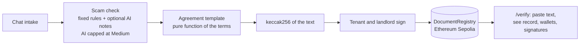
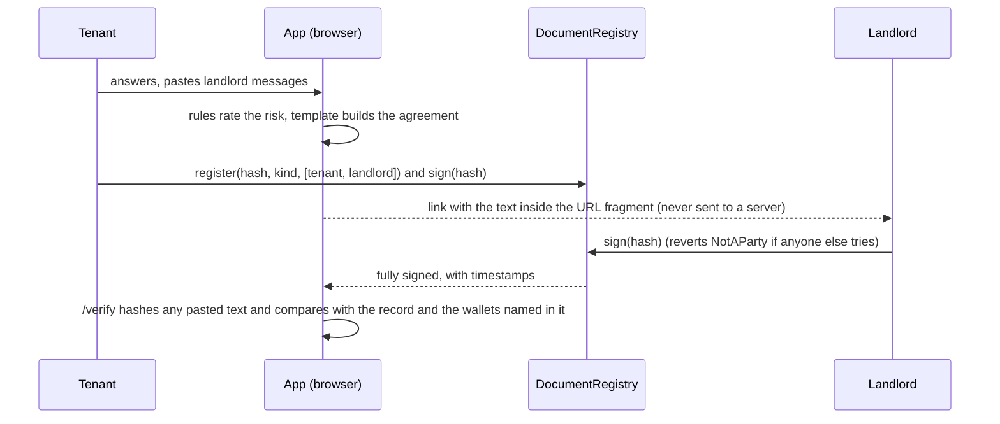

# CourtAgent: AI explains and flags. Fixed rules decide. A public record nobody can quietly rewrite.

[](https://github.com/Agozie180/CourtAgent/actions/workflows/ci.yml)


| | |
|---|---|
| **Try it** | Live demo: _add the hosted URL_ (or `npm ci && npm run dev`, 30 seconds, no keys) |
| **Demo video** | _add link_ (script: [`docs/DEMO.md`](docs/DEMO.md)) |
| **Contract on Ethereum Sepolia** | [0xd64d1fd08e81bbf5aaa194a138d005aa4d4e75ff](https://sepolia.etherscan.io/address/0xd64d1fd08e81bbf5aaa194a138d005aa4d4e75ff) |
| **Verify page** | `/verify` in the app. Paste any agreement text and see if it was recorded. |
| **Event** | [BLI Legal Tech Hackathon 2](https://dorahacks.io/hackathon/1904) (DoraHacks, Blockchain Legal Institute). Listed pool: 20,000 USD. |
| **Themes targeted** | LegalTech and RegTech (main) · Web3 for Social Good (the widow module) · AI x Blockchain (the agent) |
| **Docs** | [Architecture and non-goals](docs/ARCHITECTURE.md) · [Self-audit](AUDIT.md) · [Security](SECURITY.md) |

> **The AI never writes or changes the legal terms. It asks questions, flags risks and explains in plain language.
> The agreement is a fixed template, and only its fingerprint goes on-chain, so a changed word is caught.**

## In 10 seconds

1. Open the home page and press **Change the rent to 1,300,000**. The green **RECORDED** stamp turns red **NOT RECORDED**
   and the fingerprint changes. That is the whole idea: a signed record cannot be quietly rewritten.
2. Press **Landlord abroad, keys by courier** under the scam check. You get **HIGH RISK** and the reasons. Fixed rules
   decided that. No AI was involved, and nothing left your browser.
3. Open **Rent a home** and go all the way to a signed agreement, then switch **Acting as** to *Someone else* and press
   **Try to sign anyway**. The registry refuses a stranger.

## The problem

A Nigerian tenant often pays a year of rent to someone they have never verified, on a verbal promise, and has nothing
to show later. A widow may be pushed out of the family home by relatives, with no dated record of what the family owned.
Lawyers are expensive and the paperwork is hard to read. CourtAgent gives both a plain-language check, a fixed
agreement, a letter to send when pressured, and a record that cannot be edited afterwards.

## What it does

**Module 1, renting.** Chat intake (state, budget, rooms, landlord, terms) → scam check on the landlord's messages and
documents (Low, Medium or High, with a reason for every flag) → a deterministic tenancy agreement → tenant and landlord
each sign with their own wallet → anyone can verify the text on `/verify` → if the landlord demands you leave early,
CourtAgent writes a calm reply that quotes the signed terms and names where to get free legal help.

**Module 2, widow protection.** Register a property record while the family is together (its fingerprint goes
on-chain), then generate a notice letter to relatives who try to take the home or property.

All 36 states and the FCT can be used. **Only Lagos tenancy rules are verified.** For every other state the app uses the
notice period the parties write down and shows a visible "not checked" warning.

## How it works





## What is used, and what is deliberately not

| Surface | Used? | Evidence, or the reason it is not |
|---|---|---|
| Ethereum Sepolia and a Solidity registry | Yes | `contracts/src/DocumentRegistry.sol`, 11 contract tests, `npm run deploy:sepolia`. Deployed on Sepolia (block 11,931,735). |
| viem and an injected wallet (MetaMask) | Yes | `lib/chain/onchain.ts`. **Not yet tested in a real browser wallet.** |
| Anthropic and OpenAI over plain `fetch` | Yes, optional | `lib/ai/provider.ts`, mocked-HTTP tests. **Not yet tested with real keys.** |
| Offline rules mode | Yes | The whole product runs with no key. |
| Demo Mode (browser-local registry) | Yes | Mirrors the contract rules. Test: `lib/chain/demo.test.ts`. Clearly labelled, not tamper-proof. |
| BNB testnet | Config only | Same contract, not deployed. |
| A database | No | Records live on-chain or in your browser. The server stores nothing. |
| Zero-knowledge, Stellar, Soroban | No | Dropped from the ForgePass scaffold on purpose. |
| Legal rules for states other than Lagos | No | Not verified. The app says so on screen. |
| Mainnet or real money | No | Testnet only. |

## The thesis, enforced (not asserted)

| The system decides | The system is structurally prevented from deciding | Test |
|---|---|---|
| The agreement text, from fixed terms | The AI writing or editing it | `lib/ai/thesis.test.ts` |
| The risk level, from fixed rules | The AI raising a check to High (AI flags are capped at Medium) | `lib/ai/thesis.test.ts` |
| Whether a text was recorded | Quietly changing a word: 1,953 of 1,953 one-character edits change the fingerprint | `npm run measure`, `lib/hash/document.test.ts` |
| Who may record or sign | A stranger registering a hash for other people, or signing | `test/DocumentRegistry.ts` (F-1), `lib/chain/demo.test.ts` |
| Whether the recorder is who the text names | Someone else recording the same text and passing for the parties | `lib/hash/parties.test.ts` (F-2) |
| Where a shared document lives | A server seeing it: the share link keeps the text in the URL fragment | `lib/share.test.ts` |

## Measured

Every number has a command. Corpus numbers are from small sets **written by the author**, so they are regression
checks and not an accuracy claim (see the held-out rows).

| Claim | Number | Reproduce with |
|---|---|---|
| Unit and UI tests | 75 passing (12 files) | `npm test` |
| Contract tests | 11 passing | `npm run contracts:test` |
| Gas: register, 2 parties | 140,926 | `npm run contracts:test` (prints a `GAS` line) |
| Gas: first signature / last signature | 75,979 / 62,960 | same |
| Gas: register, 1 party (widow record) | 116,953 | same |
| Tamper sweep on a 2,349-character agreement | 1,953 of 1,953 one-character edits change the fingerprint | `npm run measure` |
| Scam rules, sample set (tuned after misses, 9 of 14 before) | 14 of 14 flagged Medium or High, 0 of 12 honest messages flagged | `npm run measure` |
| **Scam rules, held-out set (written after the rules were frozen)** | **3 of 10 unseen scams flagged, 2 of 8 honest messages wrongly flagged, 0 honest rated High** | `npm run measure` |

The held-out row does not flatter us, and we are leaving it in. Keyword rules are brittle on new wording. That is why the
seven yes/no questions, which do not depend on wording, carry most of the risk score, why an AI note can add a warning
but never a verdict, and why a Low result is always shown with "this does not prove it is genuine". Details in
[`AUDIT.md`](AUDIT.md).

## Try it in 30 seconds

Needs Node 22 or newer. No keys, no wallet.

```bash
git clone https://github.com/Agozie180/CourtAgent.git
cd CourtAgent
npm install
npm run dev        # open http://localhost:3000
```

**Copy-paste answers for the rental chat** (type one at a time on `/rent`):
`Lagos` · `1.2m a year` · `2 bedroom` · `yes` · `Lekki` · `Chief Adewale Bello` · `Ada Okeke` · `1.2m` · `12 months` ·
`100k` · `yearly` · `2026-12-01` · `12 months`

**Copy-paste landlord messages for the scam check:**
- `I am currently abroad on a mission. Pay the full rent today and I will send the keys by courier.`
- `Pay an inspection fee of 50,000 naira first, then my agent will show you the flat.`
- `Flat 3, 12 Akin Adesola Street, Lekki. Rent is NGN 1,200,000 a year. You can inspect on Saturday. An agreement and a receipt will be given when you pay.` (an honest one: Low)

**Copy-paste pressure from a landlord** (the letter step): `told me to pack out within two weeks and said he will change the lock`

The app starts in **Demo Mode**: a registry kept in your browser with fake wallets and an **Acting as** switch (Tenant,
Landlord, Property owner, Someone else). Nothing is on a blockchain in this mode and the app says so on every screen.

```bash
npm run check      # compile contracts, typecheck, lint, unit and UI tests, contract tests
npm run measure    # prints the corpus and tamper-sweep numbers quoted above
```

### Optional: AI keys

Copy `.env.example` to `.env.local` and add `ANTHROPIC_API_KEY` and/or `OPENAI_API_KEY`. Without keys CourtAgent uses its
offline rules engine. The keys are read on the server only, so never give them a `NEXT_PUBLIC_` prefix. On Vercel, add
them under Settings, Environment Variables, then **redeploy** (a running deployment does not see new variables). The page
says which mode it is really in; open `/api/status` to see it, including a hint if a key is stored under a name that is
not read. Set `NEXT_PUBLIC_REPO_PUBLIC=true` to show the "Open source" link once the repo is public.

### Optional: live on Ethereum Sepolia

1. Make a throwaway wallet and get test ETH from a Sepolia faucet (for example the Alchemy or Google Cloud Sepolia faucets).
2. Put its key in `.env.local` as `DEPLOYER_PRIVATE_KEY`. Never use a wallet that holds real funds.
3. `npm run deploy:sepolia`, then copy the printed address into `NEXT_PUBLIC_REGISTRY_ADDRESS`.
4. `npm run verify:live` confirms the contract exists on Sepolia.
5. Restart the app and use **Sepolia** mode with a browser wallet.

The contract lives in its own `contracts/` workspace (Hardhat 3) and compiles with the pinned `solc` npm package, so no compiler download is needed. Run `npm run setup` once to install both workspaces.

No computer to run it on? In GitHub, open Settings, Secrets and variables, Actions and add `DEPLOYER_PRIVATE_KEY` (throwaway wallet with test ETH). Then open the Actions tab, choose **Deploy contract**, and press **Run workflow**. It runs the contract tests, deploys, and commits `deployments/sepolia.json` with the address.

### Deploy the app on Vercel

1. Import the repo. Framework: Next.js. Node 22. No build command changes are needed.
2. Set environment variables **before the first build**: `NEXT_PUBLIC_REGISTRY_ADDRESS`, `NEXT_PUBLIC_SEPOLIA_RPC_URL` (these `NEXT_PUBLIC_*` values are inlined at build time), and optionally `ANTHROPIC_API_KEY` / `OPENAI_API_KEY`.
3. Redeploy after changing any `NEXT_PUBLIC_*` value. Without them the app runs in Demo Mode.

## Limitations, stated plainly

- **Not legal advice.** CourtAgent does not replace a lawyer or a court. The law notes were checked on 2026-10-13 and
  have **not** been reviewed by a lawyer.
- **Only Lagos rules are verified.** Other states are marked "not checked" and use the notice period the parties write.
  A 2025 Lagos tenancy Bill was not confirmed, so the 2011 Law is used.
- **The text-pattern scam rules are brittle** (3 of 10 on unseen wording, above). A Low result never proves a landlord or
  property is genuine. A hash proves a text existed and who signed it, not that the landlord owns the property.
- **No live Sepolia deployment is claimed here yet**, and **wallet mode and the AI providers have not been tested with a
  real wallet or real keys.** Only the local Hardhat chain and mocked HTTP were used.
- **Demo Mode records live in your browser** and are not tamper-proof.
- **Pasted text is processed by the server for each request.** In the full flow, text you paste for a check or an
  explanation goes to this app's API routes, and on to Anthropic or OpenAI only if you configured a key. The app does not
  store or log it. The home-page demos and `/verify` hashing run entirely in your browser.
- The rate limiter is in memory and per instance. Use a shared store for a real deployment.
- The contract is unaudited and the registry has no way to revoke or amend a record: a mistake means a new document.
- Legal aid bodies are named (Legal Aid Council, FIDA Nigeria, Lagos Office of the Public Defender) but their contact
  details are not verified here.

## Disclosures

- Built for BLI Legal Tech Hackathon 2. Not affiliated with the organisers.
- The registry idea and project scaffolding come from the author's earlier project
  [ForgePass](https://github.com/Agozie180/ForgePass) (MIT). Its Stellar, Soroban and zero-knowledge parts were not carried over.
- AI coding assistance was used while building. The commit history shows the author's own commits.

## Licence

MIT, see `LICENSE`.
