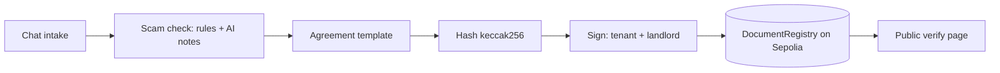

# CourtAgent

**AI that explains and flags. Fixed rules that decide. A public record nobody can quietly rewrite.**

CourtAgent helps Nigerian tenants and widows hold on to what is theirs. It is built for the
BLI Legal Tech Hackathon 2 (DoraHacks).

| | |
|---|---|
| Live app | _add your deployed URL here_ |
| Contract (Ethereum Sepolia) | _add Etherscan link after `npm run deploy:sepolia`_ |
| Demo video | _add link_ |
| Licence | MIT |

## The thesis

> The AI never writes or changes the legal terms. It asks questions, flags risks and explains in
> plain language. The agreement and the letters are fixed templates. Only a fingerprint (keccak256 hash)
> of the final text goes on-chain.

## What it does

**Module 1: renting.**
1. Chat intake: state, budget, bedrooms, parlour, area, landlord and terms.
2. Scam check on the landlord's documents: Low, Medium or High risk, with reasons.
3. Tenancy agreement drafted from a deterministic template.
4. Both parties sign. The document hash is recorded on-chain.
5. Anyone can open the public verify page and see whether a text matches the record.
6. If a landlord demands you leave early, generate a response letter that cites the agreed notice.

**Module 2: widow protection (one tab).** Record a property register (hash on-chain) and generate a
notice letter to relatives who try to take the home or property.

All 36 states and the FCT are supported. Only Lagos tenancy rules are verified so far. Other states
use the notice period the parties agree and show a visible "not checked" warning.



## Thesis enforced in code (not just claimed)

| Claim | Where it is enforced | Test |
|---|---|---|
| Agreement text is never written by AI | `lib/domain/agreement.ts` is a pure function of the terms | `lib/ai/thesis.test.ts` |
| AI cannot make a check "High risk" | `sanitizeAiFlags` caps AI flags at medium | `lib/ai/thesis.test.ts` |
| One changed word breaks the match | `lib/hash/document.ts` + verify page | `lib/hash/document.test.ts` |
| Contract rules (only listed parties sign, no overwrite) | `contracts/DocumentRegistry.sol` | `test/DocumentRegistry.ts` |
| Share links never reach a server | text lives in the URL fragment (`/verify#d=...`) | `lib/share.test.ts` |

## Used / not used

| Used | Not used |
|---|---|
| Next.js 15, React 19, TypeScript | Stellar, Soroban, Noir or ZK |
| Solidity 0.8.28, Hardhat, viem | A database (records live on-chain or in your browser) |
| Anthropic and OpenAI over plain `fetch`, plus offline mode | Any AI SDK |
| Ethereum Sepolia (testnet) | Mainnet or real money |

## Quick start (about 30 seconds)

Needs Node 20 or newer. No keys are needed.

```bash
git clone https://github.com/Agozie180/CourtAgent.git
cd CourtAgent
npm install
npm run dev        # open http://localhost:3000
```

The app starts in **Demo Mode**: a simulated registry in your browser with fake wallets and an
"Acting as" switch (Tenant, Landlord, Property owner). Nothing leaves your browser.

Run the checks:

```bash
npm run check      # typecheck, lint, unit tests, contract tests
```

### Optional: AI keys

Copy `.env.example` to `.env.local` and add `ANTHROPIC_API_KEY` and/or `OPENAI_API_KEY`.
Without keys CourtAgent uses its built-in rules engine ("offline mode").

### Optional: live on Ethereum Sepolia

1. Create a throwaway wallet and get Sepolia test ETH from a faucet.
2. Put its key in `.env.local` as `DEPLOYER_PRIVATE_KEY` (never a wallet with real funds).
3. `npm run deploy:sepolia`, then copy the printed address into `NEXT_PUBLIC_REGISTRY_ADDRESS`.
4. `npm run verify:live` confirms the contract exists on Sepolia.
5. Restart the app and use "Sepolia" mode with a browser wallet.

The contract compiles with the `solc` npm package, so no native compiler download is needed.

## Limitations (honest)

- **Not legal advice.** CourtAgent does not replace a lawyer or a court.
- **Only Lagos rules are verified** (checked 2026-10-13). Other states are marked "not checked".
- A hash proves a text existed and who signed it. It does not prove the landlord owns the property.
  The scam check lowers risk; it cannot remove it.
- Legal aid bodies are named (Legal Aid Council, FIDA, Lagos Office of the Public Defender) but their
  contact details are not verified here.
- Demo Mode records are in your browser only. They are not tamper-proof.
- The rate limiter is in-memory and per instance. Use a shared store for real deployment.
- AI paths were tested with mocked HTTP. Test with your own keys before relying on them.
- A 2025 Lagos tenancy Bill was not confirmed; the 2011 Law is used.

## Disclosures

- Built for BLI Legal Tech Hackathon 2.
- Contract-registry idea and project scaffolding borrow from the author's own earlier project,
  [ForgePass](https://github.com/Agozie180/ForgePass) (MIT).
- AI coding assistance was used while building.

## Licence

MIT, see `LICENSE`.
